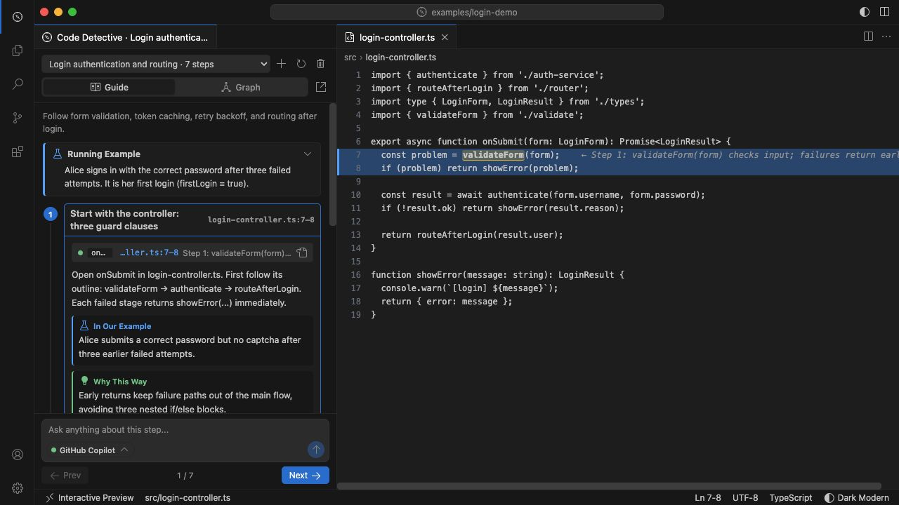

English | [简体中文](README.md)

<p align="center">
  
</p>

# Code Detective AI

**Start at one function. Understand the whole call chain.**

Code Detective turns source code into a guided walkthrough inside VS Code. Read one step at a time, jump to the actual source, ask follow-up questions, and use the call graph to see how everything connects.

[Quick start](#quick-start) · [Languages](#languages) · [AI engines](#ai-engines) · [Data and privacy](#data-and-privacy) · [Development](#development)



*Browser preview of the repository's synthetic login example. Preview Q&A is simulated.*

## What you can do

- **Explore an unfamiliar module:** follow entry points, calls, decisions, and error paths.
- **Understand a complex call chain:** inspect intermediate forwarding calls and switch between parallel implementations.
- **Keep what you learn:** save useful answers as step notes or side paths for your next read.

| As you read | Code Detective helps with |
| --- | --- |
| Follow the main flow | Step-by-step explanations, design rationale, and pitfalls |
| Check the real implementation | Source navigation, focused highlights, and cursor-to-step hints |
| Understand the bigger picture | Call graphs, expandable stages, forwarding traces, and implementation variants |
| Ask about a detail | Streaming Q&A with optional editor selection and clickable source citations |
| Check your understanding | Running examples, inline side paths, recaps, and exercises |

## Quick start

Requires **VS Code 1.95+** and a trusted desktop workspace. Reading an existing guide does not require AI. Generating guides and asking questions require an available AI engine and the appropriate account.

### 1. Install and open a project

Install [Code Detective AI from the Visual Studio Marketplace](https://marketplace.visualstudio.com/items?itemName=x1phyr.code-detective-ai). The extension ID is **`x1phyr.code-detective-ai`**.

For a local build, run **Extensions: Install from VSIX...** and select the generated VSIX under `artifacts/`.

To try the bundled examples, clone this repository and open `examples/login-demo` or `examples/bag-demo` in VS Code. Select an existing guide in the Code Detective sidebar. The checked-in guides are written in Chinese; the browser preview also includes English translations.

### 2. Start where your question begins

Right-click a function or line and choose **Code Detective: Start Walkthrough from Here**. Enter a concrete question, for example:

> Starting from the login button, walk me through form validation, authentication, and navigation.

Choose an AI engine and generate the guide. Search and file-reading activity appear while the engine explores the code.

### 3. Read, explore, and ask

Open a step and read its explanation alongside the linked source. Switch to Graph for the overview. Ask a question in the bottom composer, optionally selecting code first to attach it as context.

- Use `Alt+[` / `Alt+]` for the previous or next step (`⌥[` / `⌥]` on macOS).
- Open an inline side path for an error case or alternative flow, then return to the main line.
- Save a useful answer as a note or new side path.
- Open the full call graph in a separate editor tab for more space.

## Languages

Commands, settings, notifications, source status, schema field hints, and the extension interface follow the editor's **Display Language**. Chinese locales use Simplified Chinese; other locales use English. Change the editor's display language and reload the window to switch.

Guide and answer text follow the language of your topic or question. A question containing only a code symbol or path falls back to the guide language, then the interface language. Existing guides and saved notes retain their original text.

For the browser preview, use `?lang=en` or `?lang=zh-CN`. Both bundled demo guides are translated for the English preview; the source files themselves remain unchanged.

## AI engines

Run **Code Detective: Choose AI Engine** from the command palette. Local CLIs must already be installed, signed in, and discoverable by the editor process. The extension does not install them for you.

| Engine | `codeDetective.ai.agent` | How it works |
| --- | --- | --- |
| GitHub Copilot | `copilot` | Prefers the local Copilot CLI; can fall back to an available Copilot language model inside VS Code |
| Antigravity | `agy` | Uses the local `agy` CLI, with streamed activity and session continuation |
| Codex | `codex` | Uses the local Codex CLI with a read-only sandbox |
| Claude Code | `claude` | Uses the local Claude Code CLI with read-only workspace tools |

Without an explicit selection, engines are detected in this order: `copilot → agy → codex → claude`. Add custom CLIs through `codeDetective.ai.cli.agents`.

In VS Code with Copilot Chat support, you can also generate a guide with `@detective /map`. Compatible editors such as Cursor, Windsurf, Trae, Antigravity IDE, and VSCodium may support VSIX installation; each editor's installation policy and API support require separate testing.

## Data and privacy

- AI features send topics, questions, and relevant source context to the selected engine under that engine's account and service rules. **A local CLI does not imply an offline local model.**
- The extension does not implement its own telemetry reporting.
- Guides, source anchors, and saved answers are written to `.code-detective/maps/` in the workspace. These files can contain project names and source snippets. Review them before committing or sharing.
- CLI prompts are sent through `stdin` with `shell: false`. Built-in Copilot, Codex, and Claude arguments restrict writes or available tools. Antigravity and custom CLI permissions depend on their own configuration.

## Common commands

| Command | Purpose |
| --- | --- |
| Switch Code Guide | Select a guide from the workspace |
| Start Walkthrough from Here | Generate from the current cursor or selection |
| New AI Code Guide | Open the new-guide composer |
| Open Call Graph in Editor Tab | Open the graph alongside the guide |
| Start Walkthrough / Next Step / Previous Step | Follow the reading sequence |
| Toggle Active Code Highlight / Clear Highlights | Control focused source highlights |
| Choose AI Engine / Cancel AI Task | Select an engine or stop the current task |
| Copy AI Guide Authoring Prompt | Copy the schema prompt for another AI tool |

## Guide JSON format (Schema v1)

<details>
<summary>Protocol and examples for writing guides or integrating tools</summary>

Guides live in `.code-detective/maps/<id>.json`. See the [English JSON schema](schemas/code-map-v1.schema.json) or its [Chinese translation](schemas/code-map-v1.zh-cn.schema.json).

- `sources`: workspace-relative `file`, `startLine`, `endLine`, and optional `anchorText`, `note`, `symbol`, and `variantLabel`. Anchors allow relocation when line numbers shift.
- `walkthrough`: at least one main-line step. Each step has `id`, `title`, and source/node/edge references. Optional `description`, `why`, `watch`, `skip`, and `example` explain it. Set `aside: true` for a side path referenced through `branches`; `notes` stores saved answers.
- `tour`: optional running `example`, `recap`, and `exercise`.
- `nodes` / `edges`: function-level or module-level nodes and relationships. `parent` defines at most one level of grouping; `branch` marks a side path. Node `sourceMode` distinguishes `slices` from `variants`. A `delegated` edge with ordered `via` source IDs describes intermediate forwarding calls.

See [login-demo.json](examples/login-demo/.code-detective/maps/login-demo.json) and [bag-demo.json](examples/bag-demo/.code-detective/maps/bag-demo.json).

</details>

## Development

Requires Node.js **22.12+** and npm.

```sh
npm ci
npm run check             # Type checking, unit tests, and production build
npm run test:integration  # Extension Host tests
npm run dev               # Browser preview; add ?lang=en or ?lang=zh-CN
npm run package           # Build a VSIX under artifacts/
```

The browser defaults to the login example; add `?map=bag&lang=en` for the inventory example. Browser Q&A is simulated and does not call a real AI account.

| Directory | Responsibility |
| --- | --- |
| `shared/` | Protocol, types, and Chinese/English message catalogs |
| `src/core/` | Validation, normalization, anchors, graph projection, and navigation |
| `src/ai/` | CLI sessions, streamed activity, generation, and question prompts |
| `src/host/` | Sidebar, source highlights, editor context, Q&A, and Copilot integration |
| `webview/src/` | Vue interface, graph layout, and browser preview |
| `tests/` | Unit tests and Extension Host integration tests |

## License

Original Code Detective code is [MIT-licensed](LICENSE). Third-party components retain their own licenses; see [THIRD_PARTY_NOTICES.txt](THIRD_PARTY_NOTICES.txt).
