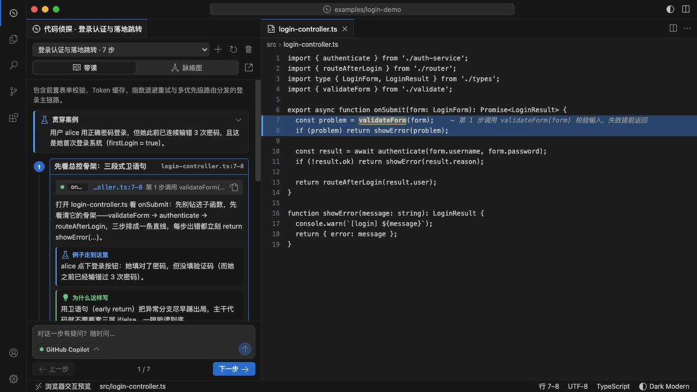
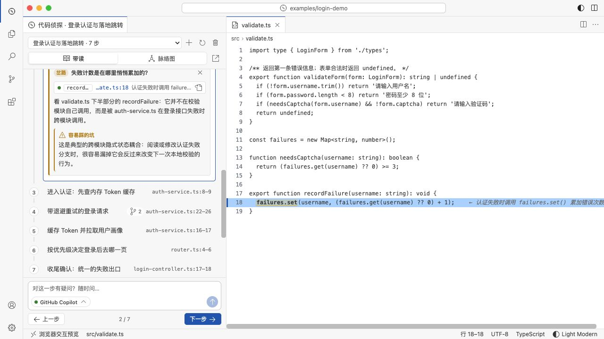

简体中文 | [English](README.en.md)

<p align="center">
  
</p>

# Code Detective AI · 代码侦探

**从一个函数出发，读懂整条调用链。**

AI-powered code walkthroughs, call graphs, and contextual Q&A in VS Code.

Code Detective 把源码组织成可逐步阅读的带读讲义：在侧栏了解当前步骤，点击跳转到真实源码，遇到不懂的地方直接追问，再用调用脉络图确认全局位置。

[快速开始](#快速开始) · [语言支持](#语言支持) · [AI 引擎](#ai-引擎) · [数据与隐私](#数据与隐私) · [开发与验证](#开发与验证)



*先读主线，再回到对应源码。截图来自仓库登录示例的浏览器预览，使用合成数据。*

## 它能帮你做什么

- **接手陌生模块**：从入口函数出发，理解后续调用、关键判断与异常分支。
- **读懂复杂调用链**：结合步骤讲解与源码定位，查看中间转发层和并列实现。
- **把理解留下来**：将追问中的解答保存为步骤笔记或岔路，方便之后重读。

| 阅读过程 | Code Detective 的支持 |
| --- | --- |
| 先弄清主线 | 分步带读讲义，说明这一步做什么、为什么这样设计、要留意什么 |
| 回到真实代码 | 跳转并高亮对应源码；自由浏览时提示光标关联的步骤 |
| 看懂全局关系 | 调用脉络图、可展开的阶段分组、跨层转发调用链与并列实现切换 |
| 追问细节 | 流式问答可附带编辑器选区，回答中的源码引用可点击跳转 |
| 验证理解 | 贯穿案例、主线外的岔路、全局复盘与动手小练习 |

界面支持中文和英文；生成讲义与追问回答的语言会跟随你的主题或问题。

<details>
<summary>查看浅色主题与内嵌岔路</summary>



岔路就在当前步骤内展开，源码同步定位；读完收起即可继续主线。此图同样来自仓库示例的浏览器预览。

</details>

## 快速开始

需要 **VS Code 1.95+**、已信任的桌面本地工作区。阅读已有讲义不需要 AI；生成新讲义和追问需要配置下方任一 AI 引擎及其可用账户。

### 1. 安装并打开项目

扩展安装标识为 **`x1phyr.code-detective-ai`**，英文显示名称为 **Code Detective AI**，中文名为 **代码侦探**。

可从 [Visual Studio Marketplace](https://marketplace.visualstudio.com/items?itemName=x1phyr.code-detective-ai) 安装；本地构建也可安装 `artifacts/code-detective-ai-0.2.1.vsix`：在 VS Code 命令面板运行 **Extensions: Install from VSIX...**，选择安装包。

想先体验示例，可以克隆本仓库后，用 VS Code 打开 `examples/login-demo` 或 `examples/bag-demo`，从左侧 **代码侦探** 面板选择已有讲义。

### 2. 从你想读懂的地方发起

在项目中的函数或代码行上右键，选择 **代码侦探：从此处开始带读**，补充一个具体问题，例如：

> 从登录按钮点击开始，带我看表单校验、认证请求和页面跳转的完整流程。

选择 AI 引擎并生成讲义；过程中可以看到检索与阅读源码的足迹。

### 3. 跟着主线阅读，随时追问

打开一个步骤，查看讲解和对应源码。需要全局视角时切到脉络图；遇到细节问题时，在底部追问框提问，或先选中代码再提问。

- 用 `Alt+[` / `Alt+]` 切换上一步、下一步（macOS 为 `⌥[` / `⌥]`）。
- 点开步骤下的岔路了解异常或旁路，阅读后返回主线。
- 将有价值的解答保存为本步笔记或新岔路。
- 从标题栏打开独立页签，宽屏查看调用脉络图。

## 语言支持

命令、设置、通知、来源状态、JSON 字段提示与插件界面自动跟随编辑器的 **显示语言（Display Language）**：中文环境使用简体中文，其他语言环境使用英文。修改编辑器显示语言并重载窗口即可切换。

讲义和追问回答跟随主题或问题的语言。问题只有代码符号或路径时，优先使用当前讲义语言，无法判断时跟随界面语言。已有讲义与笔记保留原文，不会自动翻译。

浏览器预览可用 `?lang=zh-CN` / `?lang=en` 切换；两个内置示例均提供英文预览文案，源文件内容保持原样。

## AI 引擎

在命令面板运行 **代码侦探：选择 AI 引擎**。本机 CLI 需事先安装、登录，且可被编辑器进程找到；插件不会代为安装 CLI。

| 引擎 | 设置值 `codeDetective.ai.agent` | 使用方式 |
| --- | --- | --- |
| GitHub Copilot | `copilot` | 优先使用本机 Copilot CLI；VS Code 中无 CLI 时可回退到可用的 Copilot 语言模型 |
| Antigravity | `agy` | 使用本机 `agy` CLI，支持流式足迹与会话续接 |
| Codex | `codex` | 使用本机 Codex CLI，通过只读沙箱探索源码 |
| Claude Code | `claude` | 使用本机 Claude Code CLI，限制为只读工作区工具 |

未显式固定引擎时，按 `copilot → agy → codex → claude` 顺序探测可用引擎。也可以通过 `codeDetective.ai.cli.agents` 配置自定义 CLI。

在支持 Copilot Chat 的 VS Code 中，还可使用 `@detective /map` 生成讲义。Cursor、Windsurf、Trae、Antigravity IDE、VSCodium 等兼容编辑器可尝试通过 VSIX 安装，具体安装策略和 API 支持需要分别验证。

## 数据与隐私

- AI 功能会将主题、问题及相关源码上下文交给所选引擎，按该引擎的账户与服务规则处理。**使用本机 CLI 不代表模型在本机离线运行。**
- 插件自身未实现独立遥测上报。
- 讲义、源码锚点和保存的问答写入工作区的 `.code-detective/maps/`。这些文件可能包含项目名称与源码片段，提交或分享前请检查内容。
- 所有 CLI 通过 `stdin` 接收提示词，使用 `shell: false` 调用。Copilot、Codex 与 Claude 的内置参数限制了写入或可用工具；Antigravity 和自定义 CLI 的权限取决于其自身配置。

## 常用命令

| 命令 | 用途 |
| --- | --- |
| `代码侦探: 打开带读讲义` | 选择并打开工作区中的带读讲义 |
| `代码侦探: 从此处开始带读` | 以当前编辑器光标/选区为锚点生成带读讲义（亦见编辑器右键菜单） |
| `代码侦探: 用 AI 生成带读讲义` | 打开侧栏内嵌发起框生成新讲义 |
| `代码侦探: 在新页签打开全景脉络图` | 在独立宽屏编辑器页签中打开调用脉络图并与侧栏联动 |
| `代码侦探: 开始带读` / `下一步` / `上一步` | 按主线推进阅读 |
| `代码侦探: 切换代码高亮` / `清除高亮` | 控制编辑器内当前步骤代码段高亮 |
| `代码侦探: 选择 AI 引擎` / `取消 AI 任务` | 切换 AI 引擎或中止进行中的任务 |
| `代码侦探: 复制 AI 带读生成提示词` | 复制完整 Schema 提示词给任意外部 AI |

## 讲义 JSON 格式（Schema v1）

<details>
<summary>手写讲义或接入其他工具时，查看协议与示例</summary>

讲义保存在 `.code-detective/maps/<id>.json`（Schema 见 [schemas/code-map-v1.schema.json](schemas/code-map-v1.zh-cn.schema.json)）：

- `sources`：`file`（工作区规范相对路径）、`startLine`、`endLine`，可选 `anchorText`（整行锚点文本，代码行号漂移时自动重定位）、`note`（首行行尾批注）、`symbol`（所属函数或类方法）、`variantLabel`（并列实现标签）。
- `walkthrough`（必填，至少 1 条主线步骤）：每步包含 `id`、`title`、`nodeIds`、`edgeIds`，推荐填写 `sourceId`、`description`、`why`、`watch`、`skip`、`example`；`aside: true` 表示支线岔路（由主线步骤的 `branches` 引用）；`notes` 保存用户沉淀的问答笔记。
- `tour`：可选的全局导读设定：`example`（贯穿案例）、`recap`（复盘总结）、`exercise`（课后小练习）。
- `nodes` / `edges`：6–15 个函数/模块级粗粒度节点与调用连线；可选 `parent` 指向顶层阶段节点（最多允许 1 层阶段分组），可选 `branch` 标记异常/旁路分支（默认收起为 `+N`）。节点用 `sourceMode: "slices" | "variants"` 区分同函数切片与并列实现；连线可用 `kind: "delegated"` 和有序 `via` 来源列表表达中间转发层，点击后查看完整调用链。

完整示例可参考 [login-demo.json](examples/login-demo/.code-detective/maps/login-demo.json) 与 [bag-demo.json](examples/bag-demo/.code-detective/maps/bag-demo.json)。

</details>

## 开发与验证

<details>
<summary>本地构建、调试与目录结构</summary>

需要 Node.js **22.12+** 与 npm：

```sh
npm ci
npm run check        # 类型检查 + 单元测试 + 生产构建
npm run dev          # 浏览器内交互预览（默认 login-demo，加 ?map=bag 切换背包示例）
npm run package      # 打包 artifacts/code-detective-ai-0.2.1.vsix
```

| 目录 | 职责 |
| --- | --- |
| `shared/` | 核心数据结构、双向协议与中英双语词典（`shared/i18n/`） |
| `src/core/` | JSON 严格校验、草稿收敛补锚点、单层复合图投影、导读步进与光标反查 |
| `src/ai/` | Claude / Codex / 自定义 CLI 会话、流式足迹解析、带读生成与追问提示词 |
| `src/host/` | 侧栏与独立页签控制器、克制高亮、光标跟踪、流式答疑沉淀、Copilot 引擎与 Chat 集成 |
| `webview/src/` | Vue 3 导师面板（`WalkthroughView`、`ComposerPanel`、`QaDrawer`、ELK 复合脉络图与安全 Markdown 引用渲染） |
| `tests/` | 单元测试与 Extension Host 集成测试 |

</details>

## 许可证

本项目采用 [MIT 许可证](LICENSE)。第三方组件保留各自许可证，详见 [THIRD_PARTY_NOTICES.txt](THIRD_PARTY_NOTICES.txt)。
